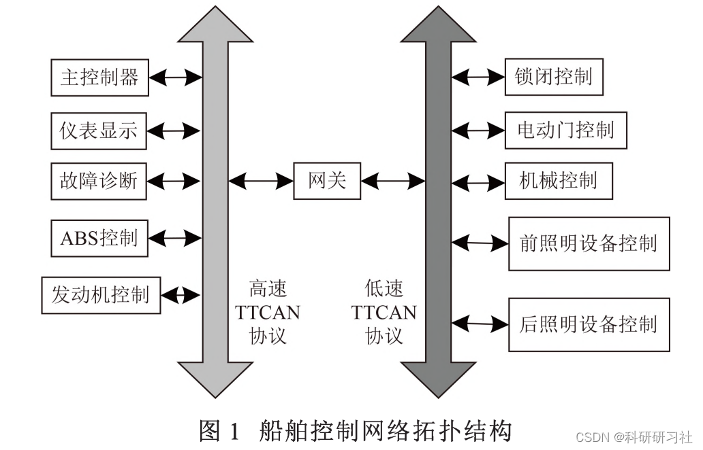
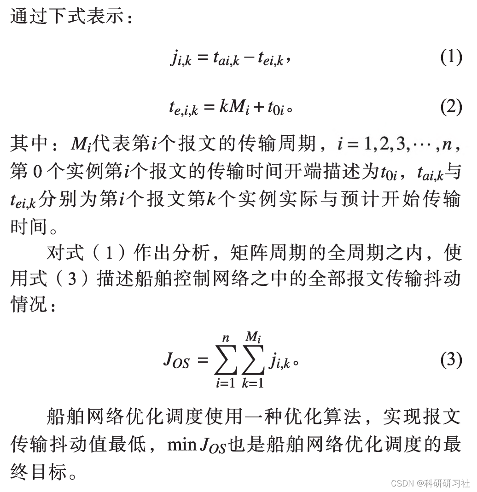

# Solving Ship Optimization Scheduling Problem Based on Simulated Annealing Algorithm (Matlab Code Implementation)

1. Overview of the Maritime Environment
During the voyage, ships face a complex and variable maritime environment, highlighting the importance of communication. Modern ship navigation no longer requires manual control; instead, it can be achieved through professional personnel controlling CNC equipment, enabling the control of ship navigation, including route planning, fault identification, and power control, all through the ship's own control system via communication channels, ensuring stable navigation R2-4. Only by reasonably scheduling the network of ships and achieving overall control over the system can the stability and safe navigation of the ship on the sea surface be ensured. Scheduling is widely applied in the field of traffic communication, combining technology from computer science, artificial intelligence, and production management science to achieve comprehensive application [5]. In the ship control system, data sharing and management across the entire ship can be realized through network communication, ensuring efficient operation of the ship.
Numerous researchers have conducted research on optimizing the scheduling of ship networks. Bao Jinsong et al. proposed using genetic algorithms as the basis for optimizing the scheduling network, but this approach tends to prematurely fall into the optimal solution, resulting in suboptimal scheduling effects. Xu Shihong et al. proposed a ship network optimization scheduling based on simulated annealing algorithm.
Editor
Editor
2 Matlab Code for Solving Ship Optimization Scheduling Problem (Matlab Code Exhibits)
This article only showcases part of the code, with all code and the full article available at the link: 
Simulated Annealing Optimization Algorithm for Solving Ship Optimization Scheduling Problem (Matlab Code Exhibits)
arrive_time = 6:1:15;\nnum_bowei = [3 3];% Number of berths\nnum_boat = 10; %Number of items worn\n\n% Simulation to solve fitness value\n[NIND,num_boat]=size(Chrom);\n\nwait_time = zeros(1,num_boat);\ndeparture_time = zeros(1,num_boat);\nservice_time = zeros(1,sum(num_bowei));\n\nc_wait = zeros(1,num_boat); % Waiting fees\nc_sail = zeros(1,num_boat); % Navigation Costs\nc_transfer = zeros(1,num_boat); % Transfer costs\n\n\nx=Chrom;\nfor j=1:1:num_boat\n    if x(j) > num_bowei(1) % Select the second port, arrival time will be delayed.\n        arrive_time(j) = arrive_time(j) + 210/40;\n        c_transfer(j) = (num_zhong(j) * 15 + num_kong(j) * 10) * 210;\n        c_sail(j) = load(j) * 5 * 210;\n    end\n    if arrive_time(j) > service_time(x(j)) % Not occupied, directly served\n        wait_time(j) = 0;\n        departure_time(j) = arrive_time(j) + load(j)*15/60;\n        service_time(x(j)) = departure_time(j);\n    else % Already occupied\n        wait_time(j) = service_time(x(j)) - arrive_time(j);\n        departure_time(j) = arrive_time(j) + wait_time(j) + load(j)*15/60;\n        service_time(x(j)) = departure_time(j);\n    end\n    \nend\nc_wait = wait_time .* 8000;\n%len = sum(wait_time);\nlen = sum(c_wait) + sum(c_sail) + sum(c_transfer);\n  
​  

## Images

<!-- PAYMENT_BLOCK -->

## Get this dataset

- Payment link (Stripe): [Buy now](https://buy.stripe.com/3cs8yP7sY87d0vu9AB)
- Payment QR code: 

<!-- /PAYMENT_BLOCK -->
